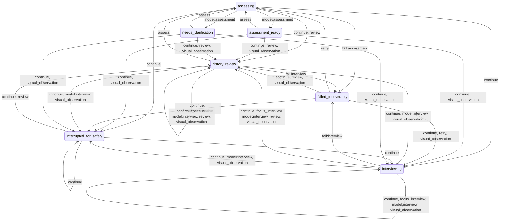

# Encounter state machine

Generated from `internal/clinical/transitions.go` by `UPDATE_STATE_DIAGRAM=1 go test -run TestTransitionTable ./internal/clinical`. Do not edit by hand.

| Action | From | To | Note |
|---|---|---|---|
| `add_outcome` | any state | `same`, `interviewing`, `interrupted_for_safety`, `history_review` | Records what happened after the visit. |
| `add_report_passage` | any state | any state | Report review keeps or routes the interview. |
| `answer` | any state | `interviewing`, `interrupted_for_safety`, `unsupported_scope`, `history_review` | Records a reply, screens it and routes the interview. |
| `assess` | `history_review`, `needs_clarification`, `assessment_ready` | `assessing` | The user requests an assessment of a confirmed history. |
| `authorize_report` | any state | any state | Report review keeps or routes the interview. |
| `change_provider` | any state | `history_review`, `unsupported_scope` | A confirmed change of model destination. |
| `clinician_feedback` | any state | `same`, `interviewing`, `interrupted_for_safety`, `unsupported_scope`, `history_review` | Feedback relayed by the user. |
| `confirm` | `history_review` | `history_review` | The user confirms this history revision. |
| `continue` | `interviewing`, `interrupted_for_safety`, `history_review`, `needs_clarification`, `assessment_ready`, `assessing`, `failed_recoverably` | `interviewing`, `interrupted_for_safety`, `history_review` | The user asks for more questions. |
| `correct_answer` | any state | `interviewing`, `interrupted_for_safety`, `unsupported_scope`, `history_review` | Replaces an answer, screens the new words and routes the interview. |
| `correct_fact` | any state | `history_review`, `interrupted_for_safety`, `unsupported_scope` | Replaces one finding and returns to review. |
| `correct_intake` | any state | `interviewing`, `interrupted_for_safety`, `unsupported_scope`, `history_review` | Changes age or pregnancy scope and routes the interview. |
| `episode_log` | any state | `same`, `interviewing`, `interrupted_for_safety`, `unsupported_scope`, `history_review` | A return-visit entry. |
| `fail:assessment` | `assessing` | `failed_recoverably` | A failed assessment keeps the history. |
| `fail:interview` | `interviewing`, `history_review` | `failed_recoverably` | A failed interview request keeps the history. |
| `focus_interview` | `interviewing` | `interviewing`, `history_review` | The user chooses a shorter interview. |
| `medication_use` | any state | `same`, `interviewing`, `interrupted_for_safety`, `unsupported_scope`, `history_review` | How a medicine is actually taken. |
| `model:assessment` | `assessing` | `assessment_ready`, `needs_clarification` | A validated assessment. |
| `model:interview` | `interviewing`, `history_review` | `interviewing`, `interrupted_for_safety`, `history_review` | A validated interview proposal. |
| `red_flag` | any state | `same`, `interrupted_for_safety` | One of the app's red-flag questions, answered on the review screen. |
| `report_emergency` | any state | `interrupted_for_safety`, `unsupported_scope` | Records an emergency answer, which always warns. |
| `report_identity` | any state | any state | Report review keeps or routes the interview. |
| `resolve_sources` | any state | `same`, `interviewing`, `interrupted_for_safety`, `unsupported_scope`, `history_review` | A reconciliation of two sources. |
| `retry` | `failed_recoverably` | `assessing`, `interviewing` | The user retries a failed model request. |
| `review` | `interviewing`, `interrupted_for_safety`, `history_review`, `needs_clarification`, `assessment_ready`, `assessing`, `failed_recoverably` | `history_review` | The user asks to review the history. |
| `review_report_row` | any state | any state | Report review keeps or routes the interview. |
| `safety_check` | any state | `same`, `interviewing`, `interrupted_for_safety`, `unsupported_scope` | The app's safety-net question. |
| `set_episode` | any state | `same` | Names or joins an episode. |
| `visual_observation` | `interviewing`, `history_review`, `needs_clarification`, `assessment_ready`, `failed_recoverably` | `interviewing`, `interrupted_for_safety`, `history_review` | Adds the user's own observation and routes the interview. |
| `withdraw_report_row` | any state | any state | Report review keeps or routes the interview. |
| `witness` | any state | `same`, `interviewing`, `interrupted_for_safety`, `unsupported_scope`, `history_review` | A witness account. |
